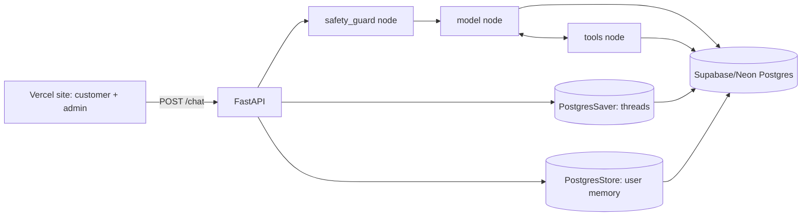

# AdForge: AI ad agency agent
Built on the AnviroAi/Workshop base (LangChain v1 `create_agent` + middleware pattern). Track 2 of the Design to Production hackathon.
Agent: Claude Haiku (`claude-haiku-5-5`), LangGraph, Postgres memory, FastAPI.

## Setup
1. Create a free Supabase or Neon database and copy the connection string.
2. `python -m venv .venv && source .venv/bin/activate && pip install -r requirements.txt`
3. `cp .env.example .env` and fill `ANTHROPIC_API_KEY`, `DATABASE_URL`, `ADMIN_KEY` (never commit `.env`).
4. `uvicorn app.api:app --reload` (tables are created on first start). `pytest` runs the rule tests (no API calls).
5. Deploy the repo as Docker on Render or HF Spaces with the same env vars; ping `/health` every 5 minutes.
6. Set `API` in `web/index.html` to your API URL and deploy `web/` on Vercel.

## API
`POST /chat {"user_id","thread_id","message"}` returns `{"reply","tool_calls","tokens":{"in","out"}}`. `GET /health` returns `ok`.

## Agent
- **Nodes:** `safety_guard` (prompt-injection regex, then a tiny Haiku check only for unclear off-topic messages), `model`, `tools`, plus summarization and call-limit nodes.
- **Tools:** `create_campaign`, `record_results`, `get_ab_report`, `list_campaigns`, `publish_campaign`, `remember`.
- **Risky action:** `publish_campaign` is two-step in code: the first call only sets `pending_publish`; it publishes only on a second call after the user confirms.

## Memory design
- **Short-term:** LangGraph `PostgresSaver`, keyed by `thread_id`, stored as `user_id:thread_id`. Long threads are summarized.
- **Long-term:** LangGraph `PostgresStore`, namespace `("memories", user_id)`, written by the `remember` tool and loaded into the prompt every turn.
- **Isolation:** `user_id` comes from the request into `AdContext`, never from the model. Tools read it from the runtime context and every SQL query filters by it. Thread ids are namespaced by user.

## Benchmark
| Metric | Result |
|---|---|
| tests.json cases passed | _fill in after running_ |
| Avg tokens per turn (in/out) | _fill in_ |
| Median latency | _fill in_ |

## Custom vs framework
Everything marked custom is in `app/middleware.py` (injection and ad-topic rules) and `app/tools.py` (campaign logic). The rest is LangChain/LangGraph.
